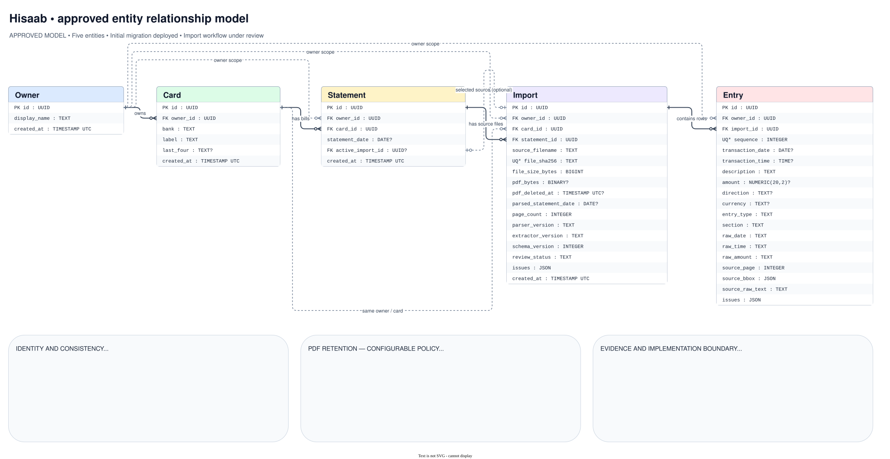

# Approved database model and migrations

The user approved the five-entity model. Initial revision `0001_initial_schema`
was applied to hosted Supabase on 2026-10-18 after PR #3 merged. No financial
statements were loaded. Subsequent implementation tests use disposable local
PostgreSQL only; see the [statement-loading guide](../statement-imports.md).

- [Editable draw.io diagram](hisaab-er.drawio)
- [SVG preview](hisaab-er.svg)
- [ORM models](../../core/persistence/models.py)
- [Initial migration](../../migrations/versions/0001_initial_schema_create_five_entity_schema.py)

Open the editable file in draw.io desktop for offline editing. The SVG is a
generated preview; regenerate it after editing the source. The diagram contains
no credentials or financial records. A test checks that its columns match the ORM.

## Five entities

Owner owns Cards; Cards have Statements; Statements have Imports; Imports have
Entries. Statement is the logical bill, while Import is one file and its
extracted evidence. `Statement.active_import_id` selects the source used for
that bill; another candidate file does not automatically replace it.

The ORM models are separate from parser dataclasses in `core/models.py`.
UUID primary keys provide stable references. All child records carry an owner.
Composite foreign keys enforce consistent owner, card, statement, and import
references, including the optional active-import pointer. ORM navigation
relationships are intentionally read-only and require explicit loading; assign
the foreign-key IDs when writing records.

Schema constraints include:
- Import uniqueness: owner, card, and original-file SHA-256.
- Entry uniqueness: import and sequence, not merchant/date/amount.
- Exact `NUMERIC(20,2)` money; nullable unresolved facts; review issues and
  original provenance retained.
- Valid directions/review states, positive page/sequence/version values,
  fingerprint length, and matching PDF byte length.
- A PDF is either present without a deletion timestamp, or absent with one.
- Restrictive foreign-key deletes: PDF retention is not a cascade deletion.

The [import service](../../core/imports.py) now adds atomic parser-to-database
loading, duplicate no-ops, conservative competing-file classification, and
same-card concurrency serialization on top of these constraints. It requires
no changes to the deployed model. Reparse/candidate-resolution workflows
remain separate work.

## PDF bytes and retention

The original PDF bytes live on Import, using SQLAlchemy LargeBinary, mapped to
PostgreSQL bytea. Normal ORM queries exclude this column. Reading the attribute
without an explicit `undefer(ImportRecord.pdf_bytes)` raises rather than silently
downloading sensitive payloads.

Configure policy in the private TOML file:

```toml
[retention]
pdf_months = 24
pdf_cleanup_enabled = false
```

Months must be a positive integer; cleanup must be a boolean. Missing settings
default to 24 months with cleanup disabled. A different duration is allowed.
`load_retention_config()` reads this policy, but this PR does not implement a
cleanup command, scheduler, or automatic deletion.

Extracted data remains indefinitely. Future cleanup must clear only PDF bytes
and set the deletion timestamp, retaining import IDs, fingerprints, entries,
and review evidence. Statement dates must not be invented. How a policy change
affects existing retained PDFs still needs confirmation before cleanup is built.
Live deletion does not erase older backups.

## Schema namespace and access boundary

The five business tables are in the private PostgreSQL schema `hisaab`, not
`public`. Alembic keeps its separate metadata ledger in
`public.hisaab_schema_version`; that is not a sixth business entity.

The migration revokes schema access from PUBLIC and enables row-level security
on all five tables without end-user policies. PostgreSQL therefore denies
ordinary non-owner roles by default. This is defense in depth, not a completed
per-user login/authorization design. The database-owner/superuser connection
can bypass RLS and is appropriate only for the trusted single-user local app.
Do not share that credential or enable a second application user yet.

## Migration workflow

SQLAlchemy 2.1.5 defines typed ORM models. Alembic 1.20.0 owns schema changes;
Psycopg 3.3.6 connects to PostgreSQL. Nothing calls create_all on app startup.

Credentials are read from the same private `config.local.toml` used by
`core db-check`. No URL is stored in `alembic.ini` or passed on a command line.

Before deployment, generate and review SQL without opening a connection or
reading private configuration:

```sh
uv sync --locked
uv run alembic upgrade head --sql
```

Initial deployment is complete. For a future reviewed migration, make an
explicit deployment/backup decision, inspect the current revision, apply it,
and verify metadata drift:

```sh
uv run alembic current
uv run alembic upgrade head
uv run alembic check
```

Upgrade creates only the private app schema, its five tables/constraints/RLS,
and the Alembic metadata ledger. It does not alter Supabase Auth/Storage tables
or import financial records. Creation fails rather than silently adopting a
pre-existing private schema. Alembic autogeneration is a draft: review every
revision, especially constraint ordering and security operations. The initial
migration explicitly adds the statement/import cyclic foreign key last.

Downgrading to base is destructive: it deletes application tables and data.
It is not a normal way to undo an application release. Back up and restore-test
before any explicitly approved downgrade. The downgrade has no CASCADE and
refuses to remove a namespace containing unexpected objects.

For application writes, `core.persistence.session.transaction(engine)` uses
one Session.begin unit of work: commit all rows or roll everything back. It does
not create schema. SQLAlchemy errors must be sanitized at future CLI boundaries.

## Disposable PostgreSQL tests

CI provisions PostgreSQL 17 and supplies only synthetic data. No Supabase
credentials are needed. To reproduce locally, start a dedicated test container:

```sh
docker run -d --name hisaab-schema-test \
  -e POSTGRES_USER=hisaab_test -e POSTGRES_DB=hisaab_test \
  -e POSTGRES_HOST_AUTH_METHOD=trust -p 127.0.0.1:55432:5432 postgres:17
HISAAB_TEST_DATABASE_URL=postgresql+psycopg://hisaab_test@127.0.0.1:55432/hisaab_test \
  uv run python -m unittest discover -s tests -v
docker rm -f hisaab-schema-test
```

Wait for pg_isready before running tests. The trust setting is for disposable
synthetic test data only, never a production database. Tests refuse hosted
hosts and database names not starting with `hisaab_test`. They never read the
private application configuration for migration/constraint integration tests.

Coverage includes upgrade/downgrade/re-upgrade, metadata drift, stable IDs and
exact amounts across a fresh engine/session, binary round-trip, deferred PDF
loading, rollback after late failure, duplicate keys, competing source files,
cross-owner reference rejection, default-deny RLS, and PDF deletion preserving
entries. This does not claim a complete authenticated multi-user app.

The existing opt-in `HISAAB_DB_TESTS=1` check is different: it reads your private
configuration and performs SELECT 1 only. Normal CI leaves it disabled.

## Portability and sources

Portable SQLAlchemy types keep application mapping independent of the driver.
The first migration/security implementation explicitly supports PostgreSQL;
another SQL engine needs migrations, authorization design, and verification.
No second persistence backend is implemented just to prove an abstraction.

- [Declarative mapped columns](https://docs.sqlalchemy.org/en/21/orm/declarative_tables.html)
- [Composite foreign keys](https://docs.sqlalchemy.org/en/21/core/constraints.html)
- [Deferred columns and raiseload](https://docs.sqlalchemy.org/en/21/orm/queryguide/columns.html)
- [Session transactions](https://docs.sqlalchemy.org/en/21/orm/session_transaction.html)
- [Alembic tutorial](https://alembic.sqlalchemy.org/en/latest/tutorial.html)
- [Autogeneration review](https://alembic.sqlalchemy.org/en/latest/autogenerate.html)
- [PostgreSQL row security](https://www.postgresql.org/docs/current/ddl-rowsecurity.html)


